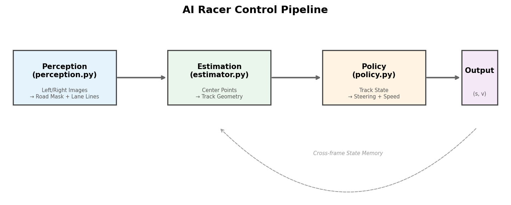

# AI Racer Controller

A camera-based controller for the PKU DSA AI Racer course challenge. It reads left and right camera frames, estimates the road, and returns steering and speed for each frame. Development happens in modular Python code; the competition artifact is a generated, self-contained `team_controller.py` file.



## How it works

```text
camera frames -> perception -> track estimate -> driving policy -> steering and speed
```

The public controller interface is:

```python
def control(left_img, right_img, timestamp):
    return steering, speed
```

Steering is bounded to `[-1, 1]`. Normal forward speed is in `[0, 1]`; the local multi-car recovery policy can briefly request negative speed to reverse out of a blockage.

| Profile | Purpose | Generated artifact |
| --- | --- | --- |
| `no_other_cars` | Solo time trials; opponent detection and multi-car recovery are disabled. | [Solo submission](submissions/no_other_cars/team_controller.py) |
| `with_other_cars` | Traffic scenarios; adds opponent avoidance and recovery behavior. | [Multi-car submission](submissions/with_other_cars/team_controller.py) |

[`controller/`](controller/) contains perception, track estimation, opponent detection, policy, parameters, and the shared interface. [`scripts/build_submission.py`](scripts/build_submission.py) assembles a single-file submission for either profile. The profiles share driving code, with explicit gates that keep traffic-specific processing out of the solo path. See the [technical manual](docs/technical_manual.md) for the design.

## Run the offline checks

From the repository root, with Python and the packages in `requirements.txt`:

```bash
python -m pip install -r requirements.txt
python -m pytest -q

python scripts/build_submission.py --mode no_other_cars
python scripts/build_submission.py --mode with_other_cars

python scripts/validate_submission.py submissions/no_other_cars/team_controller.py
python scripts/validate_submission.py submissions/with_other_cars/team_controller.py
```

The build commands regenerate the tracked submission files. The checks cover contracts and local submission rules; they do not measure driving performance. For the separate official SDK validator and a Webots run, follow [SDK setup and testing](docs/official_testing.md). That workflow uses `AIRACER_SDK` to point to an external SDK checkout.

## Key technical decisions

| Decision | Rationale |
| --- | --- |
| Perception, estimation, and control as separate modules | Pixel processing, geometric state, and driving policy can be tested and revised without hiding their assumptions in one control function. |
| Typed frame-to-frame state | `PerceptionObs`, `TrackState`, and `ControlCmd` make module contracts explicit and carry only the state needed by the next stage. |
| Temporal road-centre tracking | Previous-frame anchors stabilize ambiguous road segments while timestamp rollback and reset rules prevent stale state from leaking across runs. |
| Profile-gated multi-car behaviour | Solo and traffic submissions share the driving core, while opponent detection, avoidance, and reverse recovery execute only in the multi-car profile. |
| Generated single-file submissions | Development remains modular, but the build step produces the self-contained controller required by the competition platform. |
| Layered validation | Unit and contract tests verify deterministic logic; SDK validation checks submission constraints; Webots runs evaluate closed-loop driving behaviour. |

## Validation and evidence

The curated [`experiments/runs.csv`](experiments/runs.csv) registry and [experiment report](experiments/report.md) retain Webots and platform results, failure mechanisms, and design conclusions. Results are tied to a controller revision, profile, world, and run configuration rather than presented as timeless performance claims.

This was a **five-person team project**. My contribution centred on multi-car avoidance and recovery in the shared [perception](controller/perception.py) and [policy](controller/policy.py) pipeline: stabilizing ambiguous road segmentation with temporal state, resolving a controller-simulator command mismatch, integrating modules through shared contracts and single-file builds, and adding multi-car launch and blocked-road test procedures. The [contribution note](docs/r052_contribution_scope.md) records the reviewed scope and its relationship to later team development.

## Documentation

- [Controller architecture](docs/technical_manual.md): perception, state estimation, control, profiles, and multi-car behaviour.
- [Controller module guide](controller/README.md): source boundaries and data flow.
- [Testing guide](docs/README.md): offline tests, SDK validation, Webots execution, and run analysis.
- [Script index](scripts/README.md): build, validation, replay, and analysis commands.
- [Submission guide](submissions/README.md): generated artifacts and platform constraints.
- [Experiment archive](experiments/README.md): historical runs, failure cases, and report figures.
